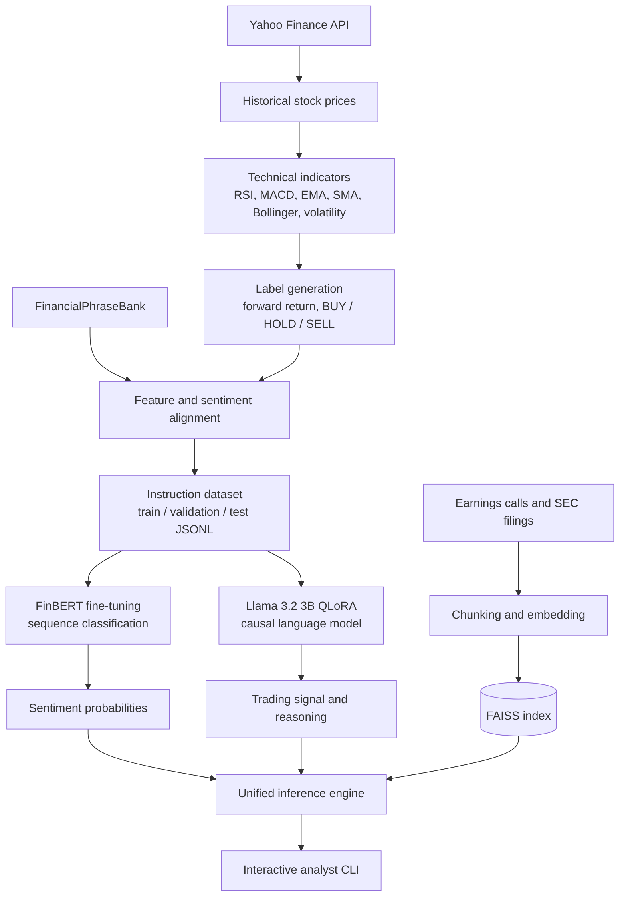
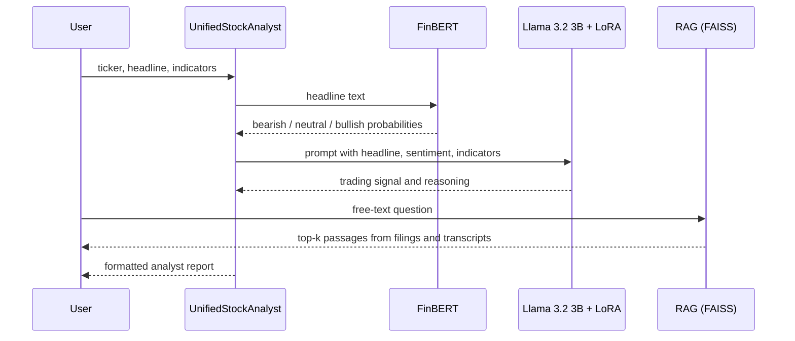
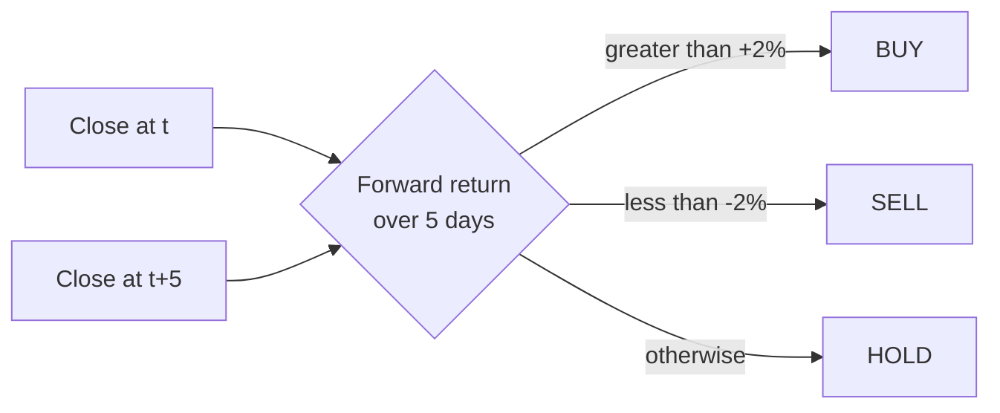
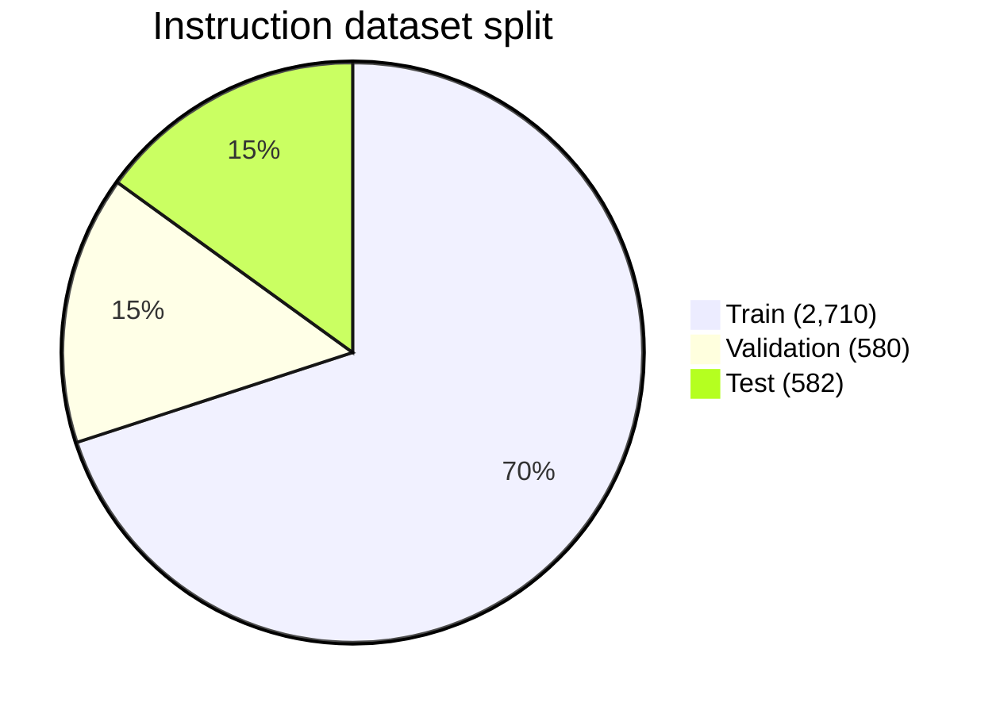
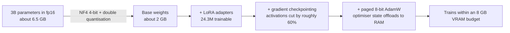
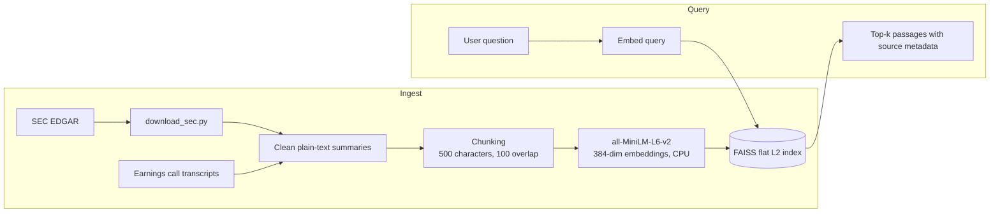
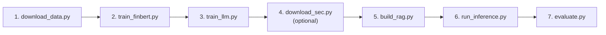
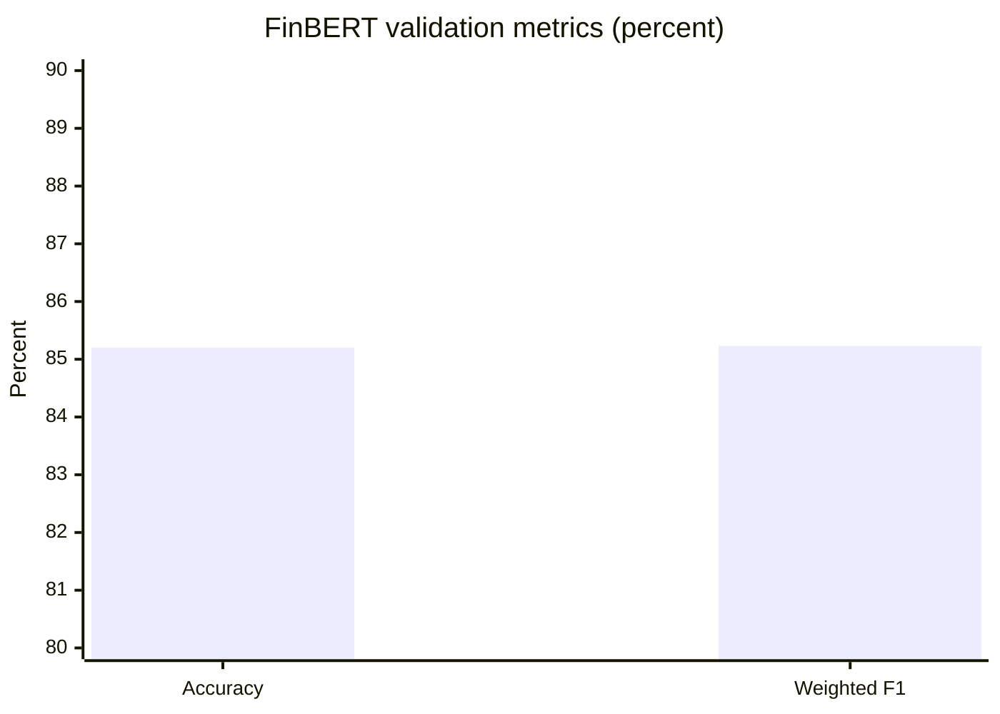

# Stock Analysis Fine-Tuning

A local, end-to-end financial analysis system that combines three components on a single consumer GPU:

1. **FinBERT** (`ProsusAI/finbert`) fine-tuned for three-class financial sentiment classification.
2. **Llama 3.2 3B Instruct** fine-tuned with **QLoRA** to produce structured trading signals (Buy / Hold / Sell) with written reasoning from a headline plus technical indicators.
3. **Retrieval-Augmented Generation (RAG)** over earnings calls and SEC filings, using `all-MiniLM-L6-v2` embeddings and a FAISS index running on CPU.

The project is tuned for an NVIDIA RTX 5060 Laptop GPU with 8 GB of VRAM (Blackwell, `sm_120`) running Windows, but every VRAM-related setting lives in `config/` and can be changed.

For a longer write-up of the design decisions, see [TECHNICAL_DOCUMENTATION.md](TECHNICAL_DOCUMENTATION.md).

---

## Table of Contents

- [Overview](#overview)
- [Architecture](#architecture)
- [Repository Layout](#repository-layout)
- [Data Pipeline](#data-pipeline)
- [Models](#models)
- [RAG Subsystem](#rag-subsystem)
- [Unified Inference](#unified-inference)
- [Getting Started](#getting-started)
- [Running the Pipeline](#running-the-pipeline)
- [Configuration Reference](#configuration-reference)
- [Results](#results)
- [Limitations and Caveats](#limitations-and-caveats)
- [Troubleshooting](#troubleshooting)
- [Disclaimer](#disclaimer)

---

## Overview

| Aspect | Detail |
|---|---|
| Task | Sentiment classification, trading-signal generation, and document question answering for equities |
| Tickers | AAPL, MSFT, GOOGL, AMZN, TSLA, NVDA, META, NFLX, AMD, INTC |
| Price history | 2020-01-01 onward, fetched with `yfinance` |
| Sentiment corpus | `lmassaron/FinancialPhraseBank` (about 3,872 labelled sentences) |
| Classifier | FinBERT, 110M parameters, 3 classes |
| Generator | Llama 3.2 3B Instruct, 4-bit NF4 quantised, LoRA rank 16 |
| Embeddings | `sentence-transformers/all-MiniLM-L6-v2`, 384 dimensions |
| Vector store | FAISS flat L2 index, CPU only |
| Target hardware | 8 GB VRAM GPU, CUDA 12.8 PyTorch wheels |

---

## Architecture



### Training and inference flow



---

## Repository Layout

```
.
|-- config/
|   |-- settings.py            Paths, tickers, date range, VRAM budget
|   `-- model_config.py        Model IDs and training hyperparameters
|-- data/
|   |-- raw/                   Raw OHLCV CSVs, news CSV, filing text
|   |   `-- documents/         Earnings calls and SEC summaries for RAG
|   |-- processed/             Indicator CSVs and Llama JSONL splits
|   |-- cache/                 Downloaded SEC EDGAR filings
|   `-- vectors/               Serialised FAISS payload
|-- scripts/
|   |-- download_data.py       Prices, news and PhraseBank, then dataset build
|   |-- train_finbert.py       FinBERT fine-tuning entry point
|   |-- train_llm.py           Llama 3.2 3B QLoRA entry point
|   |-- download_sec.py        SEC EDGAR filing downloader and cleaner
|   |-- build_rag.py           Builds the FAISS index from data/raw/documents
|   |-- run_inference.py       Interactive analyst CLI
|   |-- evaluate.py            Evaluation suite and plots
|   `-- install.ps1            Windows environment bootstrap
|-- src/
|   |-- data_pipeline/         stock_data, technical_indicators, label_generator,
|   |                          news_data, sentiment_data, preprocessor
|   |-- models/                finbert_trainer, llm_trainer, memory_utils,
|   |                          model_selector
|   |-- inference/             sentiment_engine, analyst_engine, unified_api
|   `-- rag/                   document_loader, embeddings, vector_store, copilot
|-- requirements.txt
|-- setup.py
|-- .env.example
`-- TECHNICAL_DOCUMENTATION.md
```

Trained checkpoints are written to `outputs/models/` and are intentionally not committed (see [Limitations](#limitations-and-caveats)).

---

## Data Pipeline

### 1. Market data and technical indicators

Prices are downloaded with `yfinance` and cached as CSV. Indicators are computed with the `ta` library:

| Indicator | Definition |
|---|---|
| RSI | 14-day momentum oscillator. Above 70 is overbought, below 30 is oversold |
| MACD | 12-day EMA minus 26-day EMA, with a 9-day signal line and histogram |
| EMA / SMA | EMA 12, 26, 50 and SMA 20, 50, 200 |
| Bollinger Bands | 20-day SMA plus or minus 2 standard deviations |
| Volatility | Rolling 20-day standard deviation of daily log returns |
| Volume change | Day-over-day percentage change in volume |

### 2. Trading label generation

Labels come from the forward return over a lookahead window of N = 5 trading days with a threshold of 2 percent:

```
forward_return = (close[t + N] - close[t]) / close[t]

label = BUY   (2)   if forward_return >  +2%
        SELL  (0)   if forward_return <  -2%
        HOLD  (1)   otherwise
```



### 3. Corpus construction and alignment

- **Sentiment baseline.** `lmassaron/FinancialPhraseBank`, loaded through Parquet resolution to avoid deprecated dataset loading scripts.
- **Instruction samples.** Real news headlines are sparse relative to market dates, so instruction samples are synthesised by pairing PhraseBank sentiment tags with technical-indicator distributions that are directionally consistent with that sentiment (for example, positive earnings language alongside a bullish MACD crossover and a healthy RSI).
- **Output format.** Each record is an instruction-style JSON line carrying the ticker, date, headline, price, indicators, and the target analyst response.

### Dataset sizes

| File | Rows |
|---|---|
| `llama_dataset_train.jsonl` | 2,710 |
| `llama_dataset_validation.jsonl` | 580 |
| `llama_dataset_test.jsonl` | 582 |
| `phrasebank_processed.csv` | 3,872 |
| `aligned_market_news.csv` | 3,872 |
| `<TICKER>_processed.csv` | about 1,400 per ticker |



---

## Models

### FinBERT sentiment classifier

| Setting | Value |
|---|---|
| Base model | `ProsusAI/finbert` (BERT-base, 110M parameters) |
| Classes | positive, negative, neutral |
| Learning rate | 2e-5 (AdamW) |
| Batch size | 8 train, 8 eval |
| Epochs | 3 |
| Weight decay | 0.01 |
| Training VRAM | about 1.24 GB |

### Llama 3.2 3B with QLoRA

| Setting | Value |
|---|---|
| Base model | `meta-llama/Llama-3.2-3B-Instruct` (gated), fallback `Qwen/Qwen2.5-3B-Instruct` |
| Quantisation | 4-bit NF4 with double quantisation |
| LoRA rank / alpha / dropout | 16 / 32 / 0.05 |
| LoRA target modules | `q_proj`, `k_proj`, `v_proj`, `o_proj`, `gate_proj`, `up_proj`, `down_proj` |
| Trainable parameters | about 24.3M (roughly 0.75 percent of the model) |
| Per-device batch size | 2 |
| Gradient accumulation | 8 steps, effective batch size 16 |
| Learning rate | 2e-5 |
| Epochs | 3 |
| Optimiser | `paged_adamw_8bit` |
| Gradient checkpointing | enabled |
| Checkpointing | every epoch, best model selected by `eval_loss` |
| Maximum sequence length | 512 tokens |

#### Why this fits in 8 GB



Key techniques:

- **NF4 with double quantisation** shrinks the base weights and quantises the quantisation constants themselves, saving about 0.37 bits per parameter.
- **Gradient checkpointing** recomputes activations on the backward pass instead of storing them.
- **Paged AdamW 8-bit** lets optimiser state spill into system RAM when VRAM is exhausted.
- **Windows WDDM paging.** Near the VRAM ceiling the driver pages GPU memory into system RAM. This avoids out-of-memory crashes but can make individual steps dramatically slower (observed rising from roughly 8 seconds to several minutes per step while pages swap).

---

## RAG Subsystem



| Stage | Detail |
|---|---|
| Chunking | 500 characters with 100 characters of overlap, split on sentence boundaries |
| Embeddings | `all-MiniLM-L6-v2`, about 80 MB, run on CPU to keep VRAM free for generation |
| Index | `faiss-cpu`, flat L2 distance |
| Filing downloads | `sec-edgar-downloader` with a compliant `User-Agent` |
| HTML cleaning | Standard-library `html.parser.HTMLParser`, with length caps to keep the index small |
| Output location | `data/raw/documents/{TICKER}_sec_summary.txt`, discovered automatically by the index builder |

---

## Unified Inference

`UnifiedStockAnalyst` in `src/inference/unified_api.py` runs FinBERT for fast sentiment probabilities, then feeds the headline, sentiment, and technical indicators to the fine-tuned Llama model for a structured recommendation.

Example report from the interactive CLI:

```
+--------------------------------------------------------------------------+
|                    Financial Stock Analysis Report                       |
+--------------------------------------------------------------------------+
|      Ticker Symbol: TSLA                                                 |
|     Event/Headline: "Tesla beats earnings estimates and revenue rises"   |
|          Sentiment: Bullish (92.4%)                                      |
|     Trading Signal: Buy                                                  |
|          Reasoning: Positive earnings surprise and revenue growth        |
|                     supports the momentum. MACD crossover is positive.   |
|      Probabilities: Bearish: 1.2%, Neutral: 6.4%, Bullish: 92.4%         |
+--------------------------------------------------------------------------+
```

---

## Getting Started

### Prerequisites

- Python 3.10 or newer
- An NVIDIA GPU with at least 8 GB of VRAM and a recent driver (CUDA 12.8 wheels are used)
- A Hugging Face account with access to the gated Llama 3.2 model, or willingness to use the Qwen fallback
- Several GB of free disk for model weights and checkpoints

### Installation

```powershell
# Create and activate a virtual environment
python -m venv .venv
.venv\Scripts\Activate.ps1

# PyTorch with the CUDA 12.8 wheel
pip install torch torchvision torchaudio --index-url https://download.pytorch.org/whl/cu128

# Project dependencies
pip install -r requirements.txt
pip install -e .
```

### Environment variables

Copy `.env.example` to `.env` and fill it in:

| Variable | Purpose |
|---|---|
| `HF_TOKEN` | Hugging Face access token, required for the gated Llama model |

`.env` is git-ignored. Never commit it.

---

## Running the Pipeline



```powershell
# 1. Download prices, news, and PhraseBank; build indicator CSVs and JSONL splits
python scripts\download_data.py

# 2. Fine-tune FinBERT
python scripts\train_finbert.py

# 3. Fine-tune Llama 3.2 3B with QLoRA (UTF-8 mode recommended on Windows)
$env:PYTHONUTF8 = "1"
python scripts\train_llm.py

# 4. Optional: download real SEC filings for RAG
$env:PYTHONUTF8 = "1"
python scripts\download_sec.py --tickers AAPL,TSLA --type 10-K

# 5. Build the FAISS index (includes any downloaded filings)
python scripts\build_rag.py

# 6. Interactive analyst CLI
python scripts\run_inference.py

# 7. Evaluation suite
python scripts\evaluate.py
```

The evaluation script samples up to 100 test records (fixed seed 42) because generating with the LLM on all 582 is slow, then reports classification metrics and a confusion matrix for sentiment and for trading signals.

---

## Configuration Reference

### `config/settings.py`

| Name | Default | Meaning |
|---|---|---|
| `DEFAULT_TICKERS` | 10 large-cap tech tickers | Universe for the historical dataset |
| `DEFAULT_START_DATE` | `2020-01-01` | Start of price history |
| `DEFAULT_END_DATE` | `2026-05-24` | End of price history |
| `VRAM_BUDGET_GB` | `8.0` | Memory budget used by the memory utilities |
| `MAX_SEQ_LENGTH` | `512` | Token cap to avoid out-of-memory errors |
| `HF_TOKEN` | from `.env` | Hugging Face authentication |

### `config/model_config.py`

| Name | Default |
|---|---|
| `FINBERT_MODEL_ID` | `ProsusAI/finbert` |
| `LLM_MODEL_ID` | `meta-llama/Llama-3.2-3B-Instruct` |
| `LLM_FALLBACK_MODEL_ID` | `Qwen/Qwen2.5-3B-Instruct` |
| `QLORA_R`, `QLORA_ALPHA`, `QLORA_DROPOUT` | 16, 32, 0.05 |
| `EMBEDDING_MODEL_ID` | `sentence-transformers/all-MiniLM-L6-v2` |
| `FAISS_INDEX_NAME` | `financial_rag_index` |

---

## Results

FinBERT validation performance, as recorded in the technical documentation:

| Metric | Value |
|---|---|
| Validation accuracy | 85.20% |
| Weighted F1 | 85.23% |
| Evaluation throughput | 232 samples per second |



Run `scripts/evaluate.py` to produce per-class precision, recall, F1, and confusion matrices for both the sentiment head and the Llama trading-signal output on your own checkpoints.

---

## Limitations and Caveats

- **Synthetic instruction data.** The Llama training set pairs PhraseBank sentences with indicator values that are generated to be directionally consistent with the sentiment. A headline in a record is not necessarily about the ticker it is attached to. The model therefore learns the format and the association between sentiment and indicators, not a validated market edge. Do not interpret its accuracy on the held-out split as predictive power on live markets.
- **No backtest.** There is no walk-forward backtest, transaction-cost model, or risk analysis in this repository.
- **Trained weights are not in the repo.** GitHub limits files to 100 MB and the checkpoints are several GB, so `outputs/` is git-ignored. Re-run the training scripts to reproduce them.
- **Gated model access.** Llama 3.2 requires accepting Meta's licence on Hugging Face. The configuration falls back to Qwen2.5-3B-Instruct if access is pending.
- **Small evaluation sample.** The evaluation script scores 100 sampled test records, so reported figures have wide confidence intervals.
- **Windows-focused.** Commands and paging notes assume Windows. Linux should work with the shell commands adapted.

---

## Troubleshooting

| Symptom | Likely cause and fix |
|---|---|
| CUDA out of memory during Llama training | Lower `per_device_train_batch_size` or `MAX_SEQ_LENGTH`, and keep gradient checkpointing on |
| Steps suddenly take minutes | VRAM is full and Windows is paging to system RAM. Close other GPU applications or reduce the batch size |
| `UnicodeEncodeError` on Windows | Set `$env:PYTHONUTF8 = "1"` before running the scripts |
| 401 or gated repo error for Llama | Set `HF_TOKEN` in `.env` and accept the model licence on Hugging Face, or switch to the fallback model |
| `bitsandbytes` import errors | Install a build that matches your CUDA version and driver |
| No SEC documents in RAG answers | Run `download_sec.py`, then rebuild the index with `build_rag.py` |
| `news_raw.csv` has empty rows | The news source returned no articles for those tickers. Sentiment training still works from PhraseBank |

---

## Disclaimer

This project is for research and education. Nothing here is investment advice, and its outputs must not be used to make real trading decisions.
